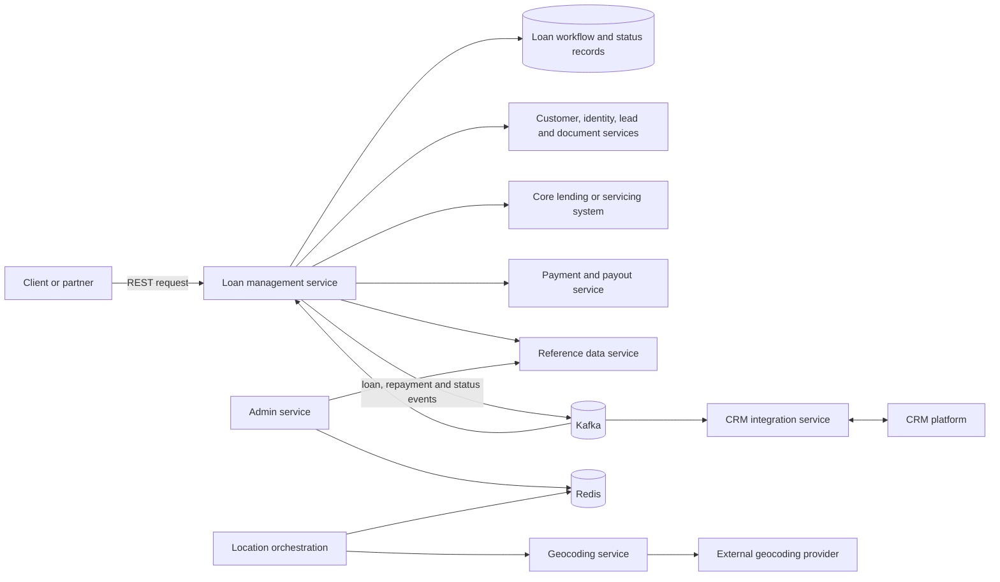

# Architecture and end-to-end flows

## How to read this guide

The supplied archive contained six Spring Boot services. The descriptions below are based on their controllers, service/client interfaces, persistence models, Kafka listeners, and build dependencies. They are an anonymized explanation of that snapshot, not a claim that every service participates in every loan request.

The archive did not include every downstream service or the full runtime environment. For example, several clients point to systems whose source was not present. Confirm deployment topology, API gateway behavior, token issuance, Kafka acknowledgement settings, and authoritative data ownership from your own project knowledge before presenting them as facts.

## Service map

| Area | What it does | Evidence in the snapshot |
|---|---|---|
| Loan management | Exposes loan, disbursement, payment, mandate, and loan-detail operations. Selects product-specific implementations and stores workflow/loan/disbursement records. | REST controllers, orchestrators, MongoDB documents and repositories, Kafka listeners and schedulers. |
| CRM integration | Maps data between the loan/origination side and a CRM. Supports inbound/outbound operations, batch/composite updates, stage events, and failed-request records. | Ingress/egress controllers, mappers, Feign clients, Kafka listener, and dead-letter-style repositories. |
| Admin | Supports administrative profiles, roles, hierarchy, employee updates, and cache operations. | Admin/role controllers, JPA repositories, Redis configuration, and an employee-update Kafka listener. |
| Location orchestration | Coordinates geo-tagging and address/coordinate lookups and keeps lookup records in Redis. | Geo-tagging controller, service clients, Redis repository, and orchestration services. |
| Geocoding | Calls an external geocoding provider to translate addresses and coordinates. | Geocoding controller and provider-backed service implementation. |
| Reference data | Serves common lookup/master data to other services, using REST and GraphQL in the snapshot. | Lookup controllers, services, repositories, MongoDB configuration, and GraphQL dependencies. |

### Related services referenced by clients

The loan-management code also declares clients for customer and lead data, identity/document services, fraud checks, case or overdue data, payments and repayments, sequence generation, reference data, and partner callbacks. Those client interfaces show integration boundaries; they do not prove that every dependency is called on every product path. Describe a specific integration only if you remember the request, response, and your own contribution.

## High-level picture

This is a conceptual map, not a deployment diagram. It intentionally omits product names, hostnames, internal API paths, and details that were not necessary to explain the design.

## Loan creation

The snapshot contains both synchronous and asynchronous product paths. Product configuration determines which orchestrator is selected.

### Synchronous path, simplified

1. A REST controller checks required request data, validates the lead and related information, and scrubs the request.
2. A product-specific orchestrator is selected through a factory/registry.
3. The workflow creates or updates a processing record and calls customer-related operations. Optional co-applicant work can run concurrently.
4. It validates/creates collateral when applicable, then calls the core lending integration to create the loan.
5. The service records the resulting loan data and starts follow-up work such as mandate and disbursement processing.

The synchronous orchestrator in the snapshot uses a try-once lock around lead-based loan creation. The lock annotation and its underlying implementation are an external dependency, so do not claim a particular distributed-lock storage mechanism without checking it.

### Asynchronous path, simplified

1. The API validates the request and product configuration.
2. The service persists a processing record, obtains or reuses a loan account reference, and stores a loan event.
3. It publishes a Kafka event and returns a response containing the assigned reference and requested loan details.
4. A consumer loads the saved processing state, creates the customer and loan with downstream systems, updates statuses, records the loan, and triggers follow-up callbacks/events.
5. A scheduled recovery job searches failed or pending work, rate-limits retries, and attempts processing again after acquiring a record-level lock.

An API response from this asynchronous path means the request reached the acceptance/enqueue stage. It does not, by itself, prove that the downstream loan system completed the operation. The producer acknowledgement and consumer offset configuration determine the exact delivery guarantees.

## Disbursement and repayment

### Disbursement

1. The service validates the loan, amount, request source, and product-specific eligibility.
2. It checks for an existing or conflicting disbursement and persists a disbursement record before initiating the payout.
3. The payment integration initiates the payout. A later status event/callback updates the disbursement and loan status.
4. The service sends permitted status updates to the originating system or partner. Split or tranche paths can coordinate multiple payout records.

The code uses stable record identifiers, duplicate-key handling, status checks, and conditional updates. Those controls help with repeat requests, but do not make an external payout exactly-once. A timeout after the provider accepted a payout still requires a status enquiry or reconciliation before retrying.

### Asynchronous repayment

For configured products, the service validates a repayment request, derives a duplicate-check key from the transaction reference and loan account, persists the request, then publishes a repayment event keyed by the loan account. The key can preserve ordering for that account when messages use the same Kafka partition. A consumer and scheduled recovery path handle later processing/status updates.

MongoDB and Kafka do not share one local transaction in this flow. Persist-before-publish plus retry/status tracking helps recover failures, but a production design must still account for the gap between a database write and a Kafka publish. An outbox or a reconciliation process is a common way to close that gap.

## Data and infrastructure

- Loan processing, loan, disbursement, and repayment records are MongoDB documents in the loan-management service.
- The admin module uses relational persistence through Spring Data JPA and also has Redis support.
- Location orchestration uses Redis for geo-tagging/lookup records; the geocoding module delegates to an external provider.
- The reference-data service includes MongoDB repositories and both REST and GraphQL interfaces.
- Kafka is used for selected asynchronous workflows and status/event communication. It does not replace synchronous REST calls where the caller needs an immediate result.
- The snapshot contains Spring Boot 3 and Java 17 build metadata, Feign-based service clients, Actuator/metrics dependencies, Dockerfiles, GitLab CI configuration, and build helper scripts. Confirm the exact production deployment and the tools you personally used.

## A concise interview explanation

> I worked on Java and Spring Boot backend services in a loan-processing platform. The loan-management service handled product-specific loan workflows, disbursement and repayment operations, and integrations with customer, lead, core lending, and payment systems. Some flows were synchronous; configured loan-creation and repayment paths persisted processing state and used Kafka so downstream work could continue asynchronously. Separate services supported CRM synchronization, administrative roles and hierarchy, location lookups, and shared reference data. My work was mainly around backend integrations and concurrent disbursement/payout workflows. I can explain the request flow, persisted state, failure handling, and the trade-offs in the areas I personally worked on.

Keep the last sentence aligned with your real responsibilities. Avoid claiming ownership of the whole platform when your contribution was to specific services or flows.

