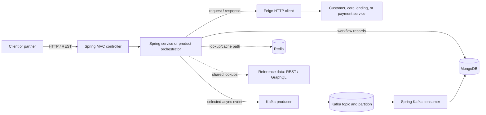

# Tech stack and how it works

This guide explains the technologies visible in the supplied service snapshot and how they fit into the loan workflows. A dependency or configuration file proves that a capability was included in the codebase; it does not, by itself, prove how production was configured or which parts I personally implemented.

## Stack at a glance

| Area | What is visible | Role in the project |
|---|---|---|
| Language and runtime | Java 17 | Implements the service logic. Selected independent work uses `CompletableFuture`. |
| Application framework | Spring Boot 3 and Spring MVC | Starts the services, wires components, and exposes HTTP controllers. |
| Document data | MongoDB with Spring Data MongoDB | Stores loan workflow, loan, disbursement, and repayment records; reference data also has Mongo repositories. |
| Relational data | Spring Data JPA in the admin service | Stores administrative profiles, roles, and hierarchy data in a relational database. The database vendor is not established by the snapshot. |
| Messaging | Apache Kafka | Moves selected loan, repayment, CRM, employee, and status events between producers and consumers. |
| Fast lookup/cache support | Redis | Supports location lookup/geo-tagging and admin/cache-related behavior. The authoritative owner of each value must be confirmed. |
| Synchronous service calls | Feign-based HTTP clients | Calls customer, lead, payment, core lending, and other downstream APIs where a direct response is needed. |
| API styles | REST and GraphQL | REST is used across service APIs; the reference-data service also exposes GraphQL. |
| Operations | Actuator and metrics libraries | Provide health/operational hooks and selected workflow measurements; endpoint exposure and monitoring backend are not established. |
| Build and packaging | Maven, Dockerfiles, GitLab CI configuration | Describe the Java build, container image inputs, and CI pipeline setup. They do not prove the production runtime platform. |

## How a request moves through the stack

The exact path depends on the product and whether the workflow is synchronous or asynchronous. A simplified view is:

For a synchronous loan path, the caller waits for the controller/orchestrator to finish its immediate work and receive a result. For a configured asynchronous path, the API stores enough workflow state, publishes an event, and returns before later consumer work completes. MongoDB and Kafka do not share one ordinary local transaction, so retries and duplicate handling still matter.

## What each part does

### Java 17 and Spring Boot 3

Java holds the domain logic and integrations. Spring Boot assembles the application context and commonly configures framework integrations based on dependencies and application settings. Spring’s dependency injection supplies controllers, services, repositories, and clients to one another. Spring MVC maps HTTP requests to controller methods and writes response objects back as HTTP responses.

### Spring Data MongoDB and Spring Data JPA

Spring Data repositories provide a data-access interface so service code can work with domain objects without repeating low-level database calls for every operation. MongoDB repositories map Java objects to documents. The loan-management module stores workflow-oriented records as documents. The admin service uses JPA entities and repositories for relational data. These are separate persistence choices; they are not one shared transaction or one common schema.

### Kafka

A producer writes an event to a topic. Kafka stores topic records in partitions; a key can influence which partition receives a record. Consumers in the same consumer group divide the topic’s partitions, and offsets track progress. Ordering is guaranteed within a partition, so the loan code’s loan-account key helps keep one account’s repayment events together. The exact topic, acknowledgement, retry, and offset settings must be checked in the project configuration before describing delivery guarantees.

### Redis

Redis stores values by key and can serve repeated lookups quickly. In this snapshot it supports location lookup/geo-tagging and admin/cache-related flows. Cache entries need a freshness rule such as expiry or explicit invalidation. If Redis holds data required to resume a business workflow, it is acting as more than a disposable cache; verify the meaning of the specific key before describing failure behavior.

### Feign clients

Feign lets a service declare an HTTP client as a Java interface. Spring provides a client implementation that maps the interface call to an HTTP request and converts the response back to Java types. This keeps request/response integration code readable. Timeouts, authentication, load balancing, error mapping, and retry policy depend on the client configuration; do not assume retries are enabled.

### REST and GraphQL

REST endpoints expose resource-oriented operations and are used throughout the service APIs. The reference-data service also exposes GraphQL, where a caller can request fields from a schema in one query. That is useful for flexible lookup consumers, but the presence of GraphQL in one module does not mean the loan workflow itself uses GraphQL.

### Maven, Docker, CI, and metrics

Maven reads the project build definition, resolves dependencies, compiles code, runs configured checks, and packages an artifact. A Dockerfile describes steps to assemble an image. GitLab CI configuration describes pipeline jobs and stages. The files show how the project was prepared to build and package; they do not establish which platform ran the containers.

Actuator and metrics dependencies can expose health and operational measurements. The code snapshot includes those dependencies and selected counters. A working production dashboard also needs endpoint exposure, a metrics registry/exporter, a collector, and dashboards/alerts; those details are not all established here.

## Interview Q&A

Answers are short speaking notes. Add an example from a change you personally made before using them in an interview.

### Easy

#### 1. Can you summarize the project’s tech stack?

It is a Java 17 and Spring Boot 3 backend. The loan workflow uses MongoDB and Spring Data MongoDB, selected asynchronous flows use Kafka, and Redis supports lookup/cache behavior. Services also make synchronous HTTP calls through Feign. The admin service uses JPA with relational persistence, while reference data supports REST and GraphQL. Maven, Dockerfiles, GitLab CI configuration, and Actuator/metrics dependencies are in the snapshot.

#### 2. What does Spring Boot add to a Java service?

It makes a Spring application easier to start and configure. It creates the application context, wires components, and applies conditional configuration for libraries that are present. The project still owns its business rules, validation, error handling, and integration behavior.

#### 3. Why are both MongoDB and a relational database present?

Different services have different data shapes. The loan workflow records are represented as MongoDB documents, while the admin service uses JPA for relational entities such as roles and hierarchy. The snapshot does not name the relational database vendor or prove why the original team selected each store.

#### 4. What is Kafka doing here?

It carries selected work and status changes asynchronously. A producer publishes an event, and a consumer can process it later without keeping the original HTTP request open for the entire downstream workflow.

#### 5. What is Redis doing here?

It supports location lookup/geo-tagging and cache-related operations. It can return frequently used values quickly, but I would check each key’s purpose before saying whether Redis is only a cache or part of workflow state.

### Medium

#### 6. What happens after a REST request reaches a Spring Boot service?

Spring MVC matches the URL and HTTP method to a controller. The controller validates/binds request data and delegates to a service or product orchestrator. That component applies business rules, calls repositories or Feign clients, and returns a response that Spring serializes as HTTP. In an asynchronous path it may persist state and publish an event before returning.

#### 7. How does a Spring Data MongoDB repository work?

The service defines a repository interface for a document type. Spring creates a proxy that implements common persistence methods and translates repository calls into MongoDB operations. Mapping converts between the Java object and stored document. Custom query methods or `MongoTemplate` can handle queries that need more control.

#### 8. How is JPA used differently in the admin service?

JPA maps Java entities and their relationships to relational tables. Spring Data JPA repositories provide common database operations over those entities. MongoDB stores document-shaped records instead. The service boundaries keep those persistence models separate; a JPA transaction does not make a Kafka publish or a remote service call atomic.

#### 9. How does a Feign call reach another service?

The application calls a Java interface method. The Feign proxy builds an HTTP request from the method mapping and arguments, sends it through its configured HTTP client, then decodes the response into a Java value. I would check the actual configuration for timeouts, credentials, error mapping, and retries before explaining those details.

#### 10. How does a Kafka event travel from producer to consumer?

The producer serializes a record and sends it to a topic. Kafka appends it to a partition, and a consumer in a group polls its assigned partitions. After processing, the consumer’s offset records its progress. If processing finishes but the offset is not committed, the record may be delivered again, so the business handler must tolerate retries.

#### 11. How do Kafka consumer groups help scale processing?

Consumers in one group share partitions, so separate partitions can be processed in parallel. A group cannot gain useful parallelism beyond the partitions available for that topic, and adding consumers can trigger a rebalance. A skewed key can leave one partition busy while others are idle.

#### 12. Why might the reference-data service expose both REST and GraphQL?

REST offers straightforward resource endpoints. GraphQL lets a client request the fields it needs from the schema, which can suit flexible lookup screens. They are two API options in the reference-data module; the supplied code does not prove which clients choose each one.

#### 13. What do Maven, Docker, and GitLab CI each contribute?

Maven manages the Java build and dependencies. Dockerfiles describe how to assemble container images. GitLab CI configuration defines automated jobs and stages such as build or test. The files are evidence of build and packaging setup, not proof that a specific pipeline passed or that production ran on Kubernetes or AWS.

### Hard

#### 14. How would you size concurrent work that uses `CompletableFuture`?

I would first identify whether the work is I/O-bound and which downstream services it calls. Then I would use a bounded, named executor with a deliberate thread limit, queue capacity, timeout, and rejection behavior instead of letting requests pile up on an unbounded executor. I would measure queue wait, active threads, completion latency, and downstream errors. Parallel calls should be independent or have explicit coordination.

#### 15. How do you scale a Kafka consumer without losing the account ordering rule?

Increase partitions and consumer capacity only after checking the key distribution and ordering requirement. Keep events for one loan account on the same partition if their order matters, which means a hot account may remain a bottleneck. I would monitor lag per partition and avoid changing the key in a way that splits one account’s sequence.

#### 16. How would you keep a Redis-backed lookup fresh?

Define whether the value is a cache or authoritative state first. For a cache, set a suitable expiry or invalidate/update it when the source changes, and decide what to do on a cache miss. Measure hit rate and stale reads. The snapshot shows Redis-backed lookups, but it does not establish a single freshness policy for every key.

#### 17. How can Actuator and metrics help debug a slow service?

Health endpoints can show whether configured components are available, and metrics can expose request latency, JVM behavior, and selected workflow counts. I would compare latency and error rates by endpoint and downstream dependency, then correlate them with logs or traces. A dependency in the build does not prove the endpoint is exposed or that a metrics backend is connected.

#### 18. What compatibility checks matter when building this stack?

Check the Java version, Spring Boot version, Spring Cloud/Feign version, and Spring Data versions declared by the build. Verify the resolved dependency tree and run compile, unit, and integration checks against the same major versions used by the service. Spring Boot 3 also moved Spring APIs to Jakarta namespaces, so older `javax.*` dependencies can cause upgrade issues.

### Tricky

#### 19. Does seeing a Dockerfile and GitLab CI file prove the service was deployed to Kubernetes?

No. They show that container packaging and pipeline configuration exist. To claim Kubernetes, I would need deployment manifests, Helm charts, pipeline steps, or reliable project knowledge showing that runtime environment.

#### 20. Does an Actuator dependency mean anyone can call `/actuator/health` in production?

No. The dependency makes Actuator features available, but endpoint exposure, security rules, network access, and production properties determine whether a given endpoint is reachable.

#### 21. Can I say the entire platform used MongoDB?

No. The snapshot shows MongoDB in the loan-management and reference-data services, while the admin service uses JPA and relational persistence. Each service’s build and configuration should be checked before describing its database.

#### 22. Can I claim I implemented OAuth 2.0 or JWT end to end from this snapshot?

Only if I can verify the actual issuer, grant, token validation, service authorization, and my own changes. The archive includes some token/authentication helpers and outbound bearer-token handling, but it does not establish the full authentication flow for every service.

## Official references

Use these to refresh the underlying concepts. For version-specific behavior, check the versions in the project’s Maven files rather than assuming the newest documentation matches the archived code.

- [Java SE 17 API](https://docs.oracle.com/en/java/javase/17/docs/api/)
- [Spring Boot reference](https://docs.spring.io/spring-boot/reference/)
- [Spring Data MongoDB reference](https://docs.spring.io/spring-data/mongodb/reference/)
- [Spring Data JPA reference](https://docs.spring.io/spring-data/jpa/reference/)
- [Apache Kafka documentation](https://kafka.apache.org/documentation/)
- [Redis documentation](https://redis.io/docs/latest/)
- [Spring Cloud OpenFeign reference](https://docs.spring.io/spring-cloud-openfeign/reference/)
- [Spring GraphQL reference](https://docs.spring.io/spring-graphql/reference/)
- [Spring Boot Actuator reference](https://docs.spring.io/spring-boot/reference/actuator/)
- [Maven build lifecycle](https://maven.apache.org/guides/introduction/introduction-to-the-lifecycle.html)
- [Dockerfile reference](https://docs.docker.com/reference/dockerfile/)
- [GitLab CI/CD pipelines](https://docs.gitlab.com/ci/pipelines/)

